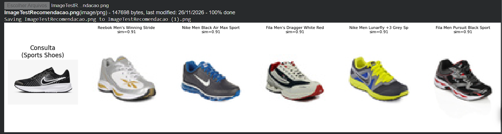

# 🖼️ Sistema de Recomendação por Imagens

Sistema que recomenda produtos **pela aparência visual** (formato, cor, textura), sem usar dados textuais como preço, marca, modelo ou loja. A partir da imagem de um produto, ele retorna os itens mais parecidos do catálogo.

[](https://colab.research.google.com/drive/14fviLXTNgN43wuQ7WjcIXx-6UkHu39Iw?authuser=1#scrollTo=8d57e8ed)

## 📌 Sobre o projeto

Em lojas online, recomendar produtos só por texto (título, categoria, marca) deixa de fora itens que *parecem* iguais ao que o usuário busca. Este projeto usa Deep Learning para comparar imagens diretamente: produtos de uma mesma classe com aparência semelhante (como os relógios brancos da imagem abaixo) ficam próximos entre si em um espaço de características, e a recomendação é feita pela proximidade.



## ⚙️ Como funciona

```
Imagem do produto
      │
      ▼
Rede CNN (MobileNetV2 + transfer learning)
      │   treinada para classificar as classes de produtos
      ▼
Embedding (vetor de 256 dimensões que representa a aparência)
      │
      ▼
Busca dos vizinhos mais próximos (similaridade de cosseno)
      │
      ▼
Top-K produtos mais parecidos
```

1. **Dataset:** [Fashion Product Images (Small)](https://www.kaggle.com/datasets/paramaggarwal/fashion-product-images-small), baixado automaticamente com `kagglehub`.
2. **Classes usadas (8):** Watches, Tshirts, Casual Shoes, Sports Shoes, Handbags, Sunglasses, Backpacks e Jeans, com 500 imagens por classe (4.000 no total).
3. **Treino:** MobileNetV2 pré-treinada na ImageNet (congelada), com *data augmentation* (flip horizontal e rotação), `Dropout` e uma camada densa de 256 neurônios (`embedding`), seguida da camada de classificação. Divisão 80% treino / 20% validação, estratificada.
4. **Embeddings:** a saída da camada `embedding` é extraída para todas as imagens e normalizada (L2).
5. **Recomendação:** `NearestNeighbors` do scikit-learn com métrica de cosseno retorna os `k` itens mais próximos da imagem consultada.

## 📊 Resultados

| Métrica | Valor |
|---|---|
| Acurácia de validação (época 6) | ≈ 93,6% |
| Melhor acurácia de validação (época 5) | ≈ 94,4% |
| Acurácia de treino (época 6) | ≈ 95,8% |
| Formato dos embeddings | 4000 × 256 |

A acurácia mede a classificação por classe. A qualidade da recomendação é avaliada visualmente: o notebook mostra a imagem consultada ao lado dos produtos recomendados, com o grau de similaridade de cada um.

## 🚀 Como executar

### No Google Colab (recomendado)
1. Clique no botão **Open In Colab** acima.
2. Ative a GPU: *Ambiente de execução → Alterar tipo de ambiente de execução → GPU*.
3. Execute todas as células (*Ambiente de execução → Executar tudo*).
4. Na última seção, envie uma imagem de um produto para receber as recomendações.

### Localmente
```bash
git clone https://github.com/DanielHespanhol/recomendacao-imagens.git
cd DanielHespanhol
pip install tensorflow scikit-learn pandas numpy matplotlib pillow kagglehub jupyter
jupyter notebook sistema_recomendacao_imagens.ipynb
```
> As células com `google.colab` (upload de arquivos e montagem do Drive) só funcionam no Colab. Localmente, carregue a imagem com `Image.open("caminho/da/imagem.jpg")`.

## 🧪 Exemplo de uso

```python
imagem = np.array(Image.open("meu_produto.jpg").convert("RGB"))
recomendar(imagem, k=5)
```

A função exibe a imagem consultada (com a classe prevista) e os 5 produtos mais parecidos do catálogo, com nome e similaridade.

## 🛠️ Tecnologias

- Python 3
- TensorFlow / Keras (MobileNetV2)
- scikit-learn
- pandas, NumPy, Matplotlib, Pillow
- Google Colab e KaggleHub

## 🔧 Possíveis melhorias

- Fazer *fine-tuning* das últimas camadas da MobileNetV2.
- Usar mais classes e mais imagens por classe.
- Testar outros modelos (EfficientNet, ResNet, CLIP) e comparar a qualidade das recomendações.
- Avaliar quantitativamente (precision@k, por exemplo, considerando recomendação correta quando a classe coincide).
- Usar índices aproximados (FAISS, Annoy) para catálogos grandes.
- Publicar como API ou aplicação web (Streamlit, Gradio ou FastAPI).

## 📄 Licença

Distribuído sob a licença MIT (ajuste conforme sua preferência). O dataset possui licença própria definida pelos autores no Kaggle.

## 👤 Autor

**Daniel Hespanhol**: [LinkedIn](https://www.linkedin.com/in/danielhespanhol-dados/) · [GitHub](https://github.com/DanielHespanhol)
